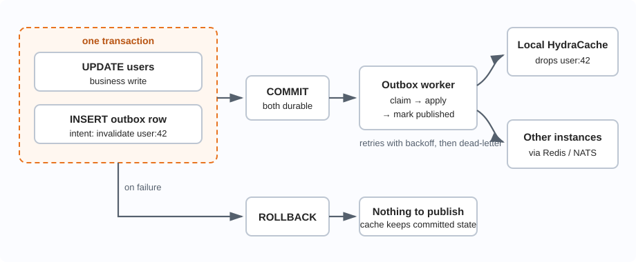

# Invalidation After Commit and the Outbox

**API:** [`InvalidationPlan`](https://docs.rs/hydracache-db/latest/hydracache_db/struct.InvalidationPlan.html) · [`InvalidationOutboxWorker`](https://docs.rs/hydracache-db/latest/hydracache_db/struct.InvalidationOutboxWorker.html) · [`SqlxInvalidationOutbox`](https://docs.rs/hydracache-sqlx/latest/hydracache_sqlx/struct.SqlxInvalidationOutbox.html)

> [!NOTE]
> **At a glance**
>
> - **Use when:** cached query results must stop being served after a write commits.
> - **Crate:** `hydracache-db` (`InvalidationPlan`); outbox with the `sqlx-outbox` feature.
> - **Guarantees:** invalidations run only after a successful commit; with the outbox, the intent is durable if and only if the write committed.
> - **Watch:** `invalidations`; outbox `pending`, `oldest_pending_age_ms`, `dead_lettered`.
> - **Pitfalls:** invalidating before commit; writers outside the service with no invalidation path.

The write path decides whether a query cache is correct. HydraCache gives you two ways to invalidate at the right moment — after the database commit — and you choose based on how much a lost invalidation would cost.

| | `InvalidationPlan` | Transactional outbox |
| --- | --- | --- |
| How | Stage tags before the write, `execute` after `commit()` | Write the intent into an outbox table in the same transaction; a worker applies it |
| Survives a crash between commit and invalidation | ❌ | ✅ the row is durable |
| Extra schema | none | one outbox table (+ schema version row) |
| Latency to invalidate | immediate | one worker drain |
| Crate | `hydracache-db` | `hydracache-db` with `sqlx-outbox` (enabled by `hydracache-sqlx`) |
| Good default for | most services; TTL covers the rare crash | money, permissions, anything where a stale read is expensive |

> [!WARNING]
> Never invalidate *before* the commit. Between the invalidation and the commit, a concurrent reader can miss, load the old row, and cache it again — and nothing will remove it until TTL.

## Option 1: InvalidationPlan

Build the plan next to the write, execute it only after a successful commit, and drop it on error or rollback:

```rust
let pending = InvalidationPlan::new().cache_entity::<User>(42);

let mut tx = pool.begin().await?;
sqlx::query("UPDATE users SET name = ? WHERE id = ?")
    .bind(name)
    .bind(42_i64)
    .execute(&mut *tx)
    .await?;
tx.commit().await?;          // `?` returns early on failure: the plan is dropped

pending.execute(&cache).await?;
```

`cache_entity::<User>(42)` stages both the entity tag (`user:42`) and the collection tag (`users`), so cached lists reload too. For inserts invalidate the collection; for deletes invalidate both. The [tutorial](../tutorial.md) runs this flow end to end across two instances.

The plan is database-neutral: the same shape works with Diesel (execute after the blocking transaction returns) and SeaORM (`db.begin()` … `tx.commit()`).

## Option 2: Transactional Outbox

<figure class="architecture-diagram">
  
</figure>

The outbox closes the crash window: the invalidation intent is written **in the same transaction** as the data, so it exists if and only if the write committed. A worker drains committed rows and applies them to the cache — and, when you use a distributed transport, to every instance.

The program below is compiled and run from `docs-site/examples/src/bin/outbox.rs`.

### Install the schema

```rust
{{#include ../../examples/src/bin/outbox.rs:install}}
```

### Enqueue inside the transaction

```rust
{{#include ../../examples/src/bin/outbox.rs:enqueue}}
```

The batch carries invalidation **intent only** — keys, tags, entities, collections, or a flush — never cached values. `CommitPosition` is an opaque marker for this write; receipts use it for read-your-writes waits (below). On Postgres use `enqueue_in_postgres_tx`.

### Drain with a worker

```rust
{{#include ../../examples/src/bin/outbox.rs:worker}}
```

`run_once` claims a batch, applies it, and marks rows published. Draining is idempotent: enqueueing the same batch at the same position twice inserts one row, and a second drain finds nothing to do. Failed applications are retried with backoff and moved to a dead-letter state after the configured number of attempts (`batch_size`, `backoff`, and `max_attempts` on the worker). `OutboxPublishReport` returns `claimed`, `published`, `retried`, and `dead_lettered` for each iteration.

### Rollback leaves nothing behind

```rust
{{#include ../../examples/src/bin/outbox.rs:rollback}}
```

## Read-your-writes After a Write

Sometimes the caller that just wrote must not read its own stale value — for example, a redirect to the page it just edited. An `InvalidationReceipt` for the write's commit position, combined with `InvalidationWait`, waits until that specific write's invalidation has been applied. A dead-lettered row reports a degraded outcome; it is never treated as satisfied.

## Operating the Outbox

- **Watch `status`.** `outbox.status(namespace)` reports `pending`, `oldest_pending_age_ms`, `dead_lettered`, `failed_attempts`, and `last_published_at_ms`. Alert on growing `pending` and on any dead letters.
- **Schema is versioned.** The worker refuses to run against a missing schema or an unknown future version instead of guessing.
- **External writers.** Batch jobs and other services can insert the same intent rows; the worker does not care who wrote them.
- **Postgres wake-ups.** On Postgres, a `LISTEN/NOTIFY` listener (`PgNotifyIntentSource`) can wake the worker as soon as a row is committed instead of waiting for the next poll.

## Next Steps

- [Tutorial: Two Instances](../tutorial.md) — `InvalidationPlan` across instances
- [Consistency Model](../concepts/consistency-model.md) — what invalidation after commit guarantees
- [SQL Dependency Lint](sql-lint.md) — check which tables your cached queries depend on
