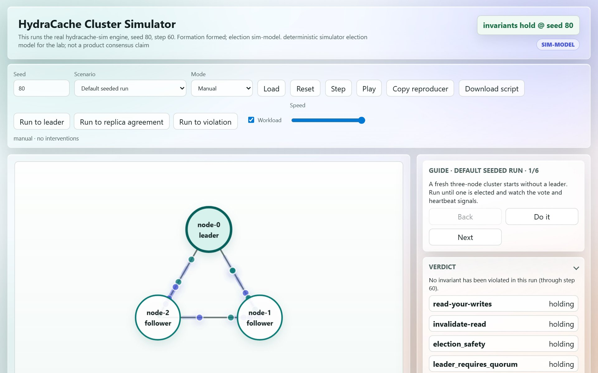

# HydraCache

  
  
The Rust cache that knows your database.

  
Embedded, query-result-aware, correctness-first — grows from an in-process cache into a distributed cache grid on one codebase.

  

    <a class="hc-btn hc-btn-primary" href="getting-started.html">Get started</a>
    <a class="hc-btn" href="https://javaquasar.github.io/hydracache/demo/">Try the cluster simulator</a>
    <a class="hc-btn" href="https://github.com/javaquasar/hydracache">GitHub</a>
  

Most caches are opaque key→blob stores: they know nothing about the database behind them, so freshness is left to TTL guesses and hand-rolled cache busting. HydraCache lives **inside your Rust service**, next to SQLx, Diesel, or SeaORM, and makes the cache contract explicit enough for code review:

- what exact value is being reused?
- which writes can make it unsafe?
- what freshness policy applies while the backing source changes?

## Why HydraCache

  

    <h3>🔗 Built for SQL-backed services</h3>
    
Cache query results by entity and collection, invalidate them after commit with transaction-aware plans or a transactional outbox, and lint SQL dependencies of cache policies at build time.

  

  

    <h3>✅ Correctness you can audit</h3>
    
Single-flight loading, fail-loud errors instead of silent degradation, per-operation consistency levels, and a deterministic seeded fault simulator with invariant checkers enforced in CI.

  

  

    <h3>📈 Embedded → cluster → geo</h3>
    
Start with an in-process cache. Add distributed invalidation, a raft control plane, peer fetch, resharding, and multi-region links later — opt-in crates that leave embedded behavior unchanged.

  

  

    <h3>🦀 Rust-native, nothing extra to run</h3>
    
No JVM, no sidecar, no proxy for the embedded case. When you want a server, there is a standalone daemon with TLS, a client protocol, and an optional Redis RESP facade.

  

## See It Run

The cluster layer is developed against a deterministic simulator. The [interactive demo](https://javaquasar.github.io/hydracache/demo/) runs the real `hydracache-sim` engine and invariant checkers in your browser: elect a leader, partition the network, crash a node, and replay any run from its seed.

<figure class="hc-screenshot">
  
  <figcaption>Three-node cluster at seed 80, step 60: a leader is elected and every invariant holds. Click to open this exact run.</figcaption>
</figure>

## Choose Your Path

| Goal | Start here |
| --- | --- |
| Cache one local value or loader | [Local Cache](guides/local-cache.md) |
| Reuse one typed namespace across call sites | [Typed Cache](guides/typed-cache.md) |
| Cache ordinary async functions | [Cacheable Functions](guides/cacheable-functions.md) |
| Use function and entity macros | [Macros](guides/macros.md) |
| Cache repository or query results | [Database Query Caching](guides/database-query-caching.md) |
| Pick SQLx, Diesel, or SeaORM integration | [SQLx](guides/sqlx-adapter.md), [Diesel](guides/diesel-adapter.md), [SeaORM](guides/seaorm-adapter.md) |
| Share invalidation across processes | [Distributed Invalidation](guides/distributed-invalidation.md) |
| Run members, clients, and a cluster | [Client and Member Cluster](guides/client-member-cluster.md) |
| Expose a Redis-compatible RESP edge | [Redis API](guides/redis-api.md) |
| Inspect logical memory ownership and retained-byte estimates | [Memory Accounting](guides/memory-accounting.md) |
| Review production readiness | [Production Checklist](production-checklist.md) |
| Avoid common cache mistakes | [Anti-patterns](anti-patterns.md) |

## First Path

If you are new to HydraCache, read these pages in order:

1. [Getting Started](getting-started.md)
2. [Architecture](architecture.md)
3. [Keys and Tags](concepts/keys-and-tags.md)
4. [Local Cache](guides/local-cache.md)
5. [Database Query Caching](guides/database-query-caching.md)
6. [Decision Guide](decision-guide.md)
7. [Production Checklist](production-checklist.md)

Concepts explain why the API is shaped this way; guides show how to use it. Use [Use Cases](use-cases.md) for concrete scenarios and [API Links](reference/api-links.md) for exact Rust signatures on docs.rs.

## Project Links

- [GitHub repository](https://github.com/javaquasar/hydracache)
- [crates.io package](https://crates.io/crates/hydracache)
- [docs.rs API](https://docs.rs/hydracache/latest/hydracache/)
- [Release archive](releases/index.md)

Background reading: the Medium series behind several of these concepts — [cache semantics](https://medium.com/@artur.buzov/why-rust-needs-cache-semantics-not-just-another-cache-map-ecf3c4e01191), [single-flight](https://medium.com/@artur.buzov/single-flight-is-not-an-optimization-85917bdbe77d), [TTL is not enough](https://medium.com/@artur.buzov/ttl-is-not-enough-ec4e96d89546), [local-first invalidation](https://medium.com/@artur.buzov/local-first-distributed-invalidation-87bf0249e935), and [typed query caching](https://medium.com/@artur.buzov/typed-query-caching-in-rust-aac4352599f0).
